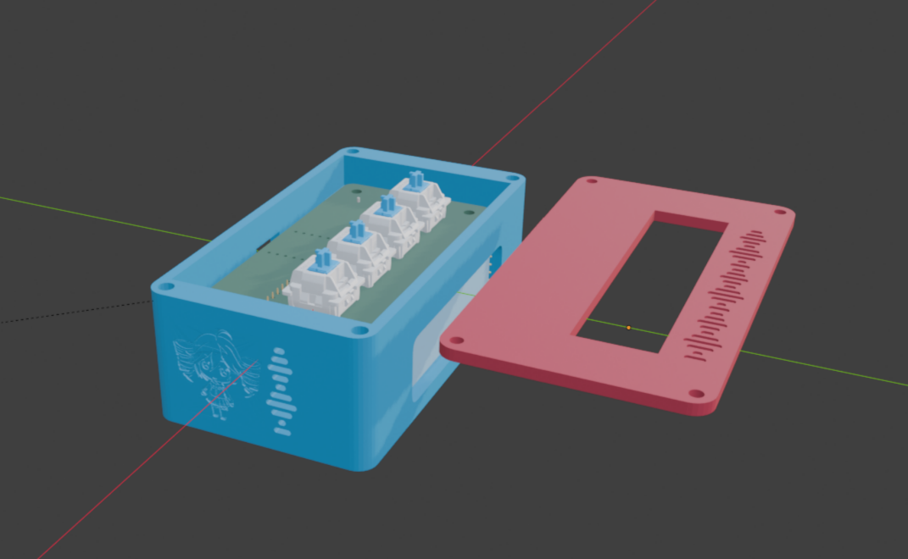
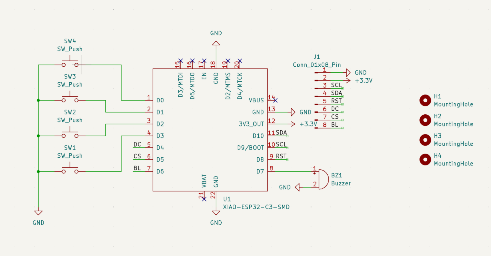
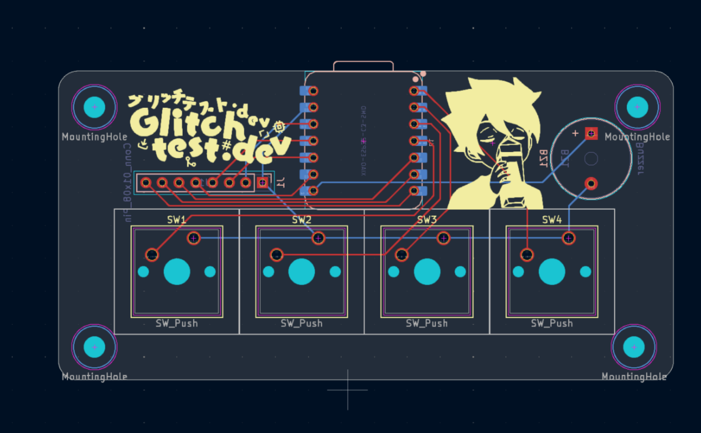
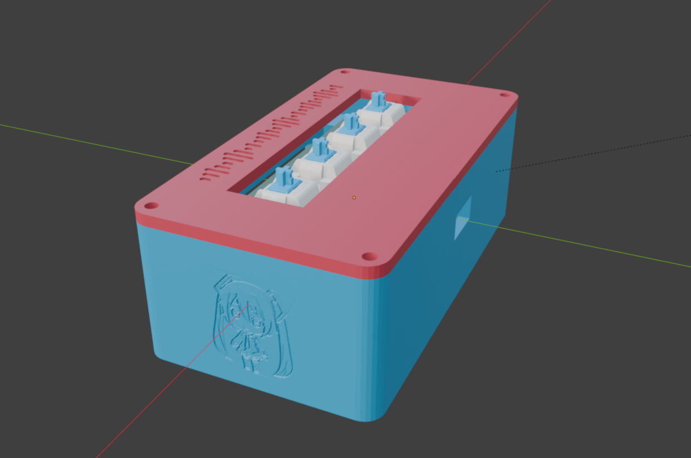

# BLARE

  

  

### Challenges
 
This is the first time I've used Kicad and Onshape, Onshape was personally quite hard to get the hang of, but I was able to finish the model 🥹.

I also wanted to add the indents of miku and teto, which i didnt realize would be as hard as it was, i used Blender to do it, while the main model was made in Onshape. Though Blender's subtraction boolean really didnt like the tiny details and kept bugging out, the image was also a bit too noisy so it made really wild ridges, i ended up Posterizing the image to 8 colors in Krita and then to add the mesh, instead of subtraction i just replaced the mesh by cutting a hole and joining them. Its not perfect but it works for me.

### Specifications

BOM: 
- 1x Seeed XIAO RP2040
- 4x MX-Style Keyboard Switches
- 4x Blank DSA Keycaps
- 8x M3x5x4 Heatset Inserts
- 4x M3x8mm Screws
- 4x M3x16mm Screws

Others:
- firmware.ino
- Top Case.stl 
- Bottom Case.stl

Schematic            |  PCB         |   Case
:-------------------------:|:-------------------------:|:-------------------------:|
    |    | 